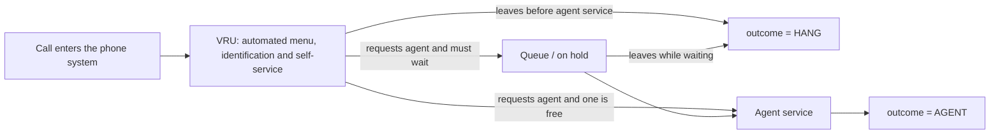

# AnonymousBank data guide

This guide explains what the AnonymousBank records describe, how a call moves through the recorded system, and what the Week 1 teaching extract keeps and leaves out.

## Where the data come from

AnonymousBank is a one-year operational log from an Israeli bank call centre. The records cover January through December 1999 at the level of individual phone calls. They were organized by Ilan Guedj and Avi Mandelbaum at the Technion and are published through the [Technion SEE Lab data repository](https://seelab.net.technion.ac.il/data/).

The official [AnonymousBank documentation](https://see-center.iem.technion.ac.il/databases/AnonymousBank/Data/AnonymousBank.pdf) describes a centre with eight general agent positions, one supervisor position, and five positions for internet services. Human agents normally worked Sunday–Thursday from 07:00 to midnight, with shorter weekend opening. The automated telephone service operated continuously.

The repository permits free academic use and asks users to notify Prof. Avi Mandelbaum or the SEE Research Team and acknowledge the source. See the [data build notes](README.md) before using the files in teaching or research.

## How one call moves through the system



**VRU** means **Voice Response Unit**, also called an interactive voice response system (IVR). It is the automated system a caller reaches first. It can identify a customer, present menus, provide self-service information, or route the call toward a human agent.

The three recorded outcomes are:

- `AGENT`: the call received human-agent service. The caller may have waited in a queue or may have gone directly to an available agent.
- `HANG`: the caller hung up before receiving agent service. A zero queue-start time means the call never reached the queue; a nonzero queue-start time means the caller joined the queue and then abandoned it.
- `PHANTOM`: the source documentation calls this a “virtual call to be ignored” and says its precise meaning was unclear to the document authors. The course therefore excludes these records and makes no stronger claim about their cause.

`AGENT` is an **outcome label**, not a separate service stage or a particular employee. Human-agent service is the activity recorded between `ser_start` and `ser_exit`; when that activity occurred, the `outcome` field normally contains `AGENT`. The employee who handled it is recorded separately in `server`.

This path is simplified. In particular, the raw records do not by themselves reveal every choice made inside the VRU, and `HANG` does not tell us why a caller left.

## What one raw record contains

Each monthly plain-text file is tab-separated, with one row per recorded call and 17 columns.

| Field | Meaning | Format or important values |
| --- | --- | --- |
| `vru+line` | VRU unit and telephone line assigned to the call | Six VRUs, labelled `AA01`–`AA06`, with numbered lines |
| `call_id` | Identifier assigned to the call | Not necessarily consecutive |
| `customer_id` | Identifier of the caller | `0` if the system did not identify the caller |
| `priority` | Queue priority category | `0` or `1`: regular/unidentified; `2`: priority |
| `type` | Requested service category | `PS`, `PE`, `IN`, `NE`, `NW`, or `TT`; see below |
| `date` | Calendar date | `YYMMDD`, for example `991101` |
| `vru_entry` | Time the call entered the VRU | Time of day |
| `vru_exit` | Time the call left the VRU | Toward a queue, directly to service, or out of the system |
| `vru_time` | Time spent in the VRU | Seconds |
| `q_start` | Time the caller joined the queue | `00:00:00` if the queue was not reached |
| `q_exit` | Time the caller left the queue | For service or because the caller abandoned |
| `q_time` | Time spent in the queue | Seconds; zero if no queue was recorded |
| `outcome` | Recorded end state | `AGENT`, `HANG`, or `PHANTOM` |
| `ser_start` | Start time of human-agent service | Zero if no service was recorded |
| `ser_exit` | End time of human-agent service | Zero if no service was recorded |
| `ser_time` | Human-agent service duration | Seconds; zero if no service was recorded |
| `server` | Name of the serving agent | `NO_SERVER` if no agent was recorded |

The service-type codes in the source documentation are:

| Code | Service |
| --- | --- |
| `PS` | Regular banking activity |
| `PE` | Regular banking activity in English |
| `IN` | Internet consulting |
| `NE` | Stock-exchange activity |
| `NW` | Information for a prospective customer |
| `TT` | A returned-call case that was put on hold because the calling agent became busy |

Priority callers were given a 1.5-minute credit in their recorded queue position. This means priority affects the order of service and must be considered in any later queue model.

## Redacted view of the raw data

The source file begins with all 17 column names. The two rows below retain the timing and outcome fields from November examples but omit the VRU line, call ID, customer ID, priority, and agent name. Those omitted columns can identify a call, customer, or employee and must not be copied into public course material or an LLM prompt.

```text
type  date    vru_entry  vru_exit  vru_time  q_start   q_exit    q_time  outcome  ser_start  ser_exit  ser_time
PS    991101  06:31:36   06:31:47  11        00:00:00  00:00:00  0       HANG     00:00:00   00:00:00  0
PE    991101  07:14:55   07:14:59  4         07:14:59  07:15:17  18      AGENT    07:15:16   07:23:16  480
```

The first row records a caller who spent 11 seconds in the VRU and never entered the agent queue. The second records a caller who spent 4 seconds in the VRU, waited about 18 seconds, and then received 480 seconds of agent service. One-second overlaps or offsets between adjacent timestamps occur in the source and should be treated as a data-quality issue rather than silently “corrected.”

## What the Week 1 CSV contains

[`anonymousbank_nov1999_arrivals_15min.csv`](anonymousbank_nov1999_arrivals_15min.csv) is a derived, non-identifying table with only three columns:

| Column | Meaning |
| --- | --- |
| `date` | Local calendar date in ISO format |
| `time` | Start of a 15-minute interval |
| `entries` | Number of non-`PHANTOM` records whose `vru_entry` time falls in that interval |

For example:

```csv
date,time,entries
1999-11-01,10:00,49
```

This means that 49 retained calls entered the **VRU** between 10:00:00 and 10:14:59 on 1 November 1999. It does **not** mean that 49 callers joined the agent queue, that 49 callers were waiting at 10:00, or that 49 callers received service.

The extract includes both `AGENT` and `HANG` outcomes and excludes `PHANTOM`. It has 2,880 quarter-hour intervals across 30 days and 40,722 retained entries. Empty intervals appear explicitly with `entries = 0`.

## How the Week 1 displays use these counts

The lecture's daily plot shows the 96 individual CSV counts on **1 November 1999**. Each point is one 15-minute interval; no moving average or averaging across days is applied. The notebook first shows the same counts as a text bar chart.

The first model then uses **all 2,880 November intervals** to estimate one constant rate. This deliberately ignores clock time and date. The later hourly comparison averages the four quarter-hour counts within each clock hour over all 30 dates: 120 counts per displayed mean. Its units remain entries per 15-minute interval.

These views ask two separate questions: does the rate vary within a day, and does the daily pattern differ across dates or weekdays? A single-day plot cannot establish a weekly pattern. The documented normal working days at this centre are Sunday–Thursday, which matters when defining comparable day types.

## What can and cannot be studied from this extract

The Week 1 table can be used to study when calls entered the phone system, variation in entry counts, empty intervals, time-of-day patterns, and whether a proposed arrival-count model reproduces those features.

It cannot by itself estimate waiting time or the effect of another agent. That decision also needs at least:

- which calls requested an agent and when they joined the queue;
- service durations and service categories;
- the number and skills of agents working over time;
- which callers abandoned and how long they waited;
- the routing and priority rules used by the centre.

These are separate measurements because arrivals describe demand, while staffing, service, routing, and patience determine how that demand becomes congestion.

## Data quality and privacy

“AnonymousBank” is the name of the dataset, but the raw files contain customer identifiers and employee names. Keep the archive and row-level files in the ignored `data/raw/` directory. Do not commit them, publish screenshots of raw rows, or send them to an LLM.

The raw timestamps and durations are operational records rather than guaranteed ground truth. The source contains zero timestamps for stages not reached, occasional boundary offsets, and service records that require cleaning before fitting a service-time distribution. Every analysis must state its population, filters, time window, and treatment of anomalous records.

## Sources

- Ilan Guedj and Avi Mandelbaum, [*“Anonymous Bank” Call-Center Data*](https://see-center.iem.technion.ac.il/databases/AnonymousBank/Data/AnonymousBank.pdf), source documentation, 2000.
- Technion SEE Lab, [Data Repository](https://seelab.net.technion.ac.il/data/).
- Lawrence Brown et al., [“Statistical Analysis of a Telephone Call Center: A Queueing-Science Perspective”](https://doi.org/10.1198/016214504000001808), *Journal of the American Statistical Association* 100 (2005), 36–50.
